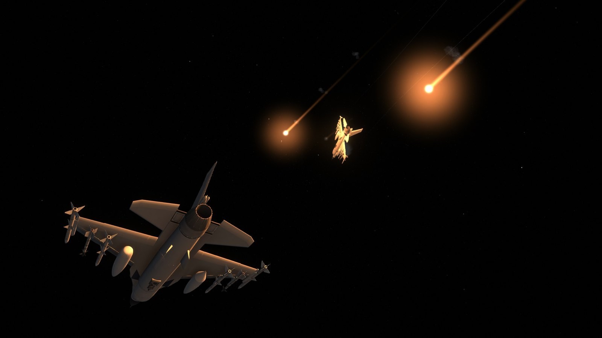
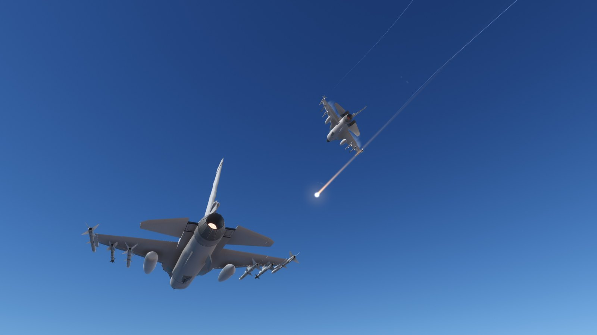
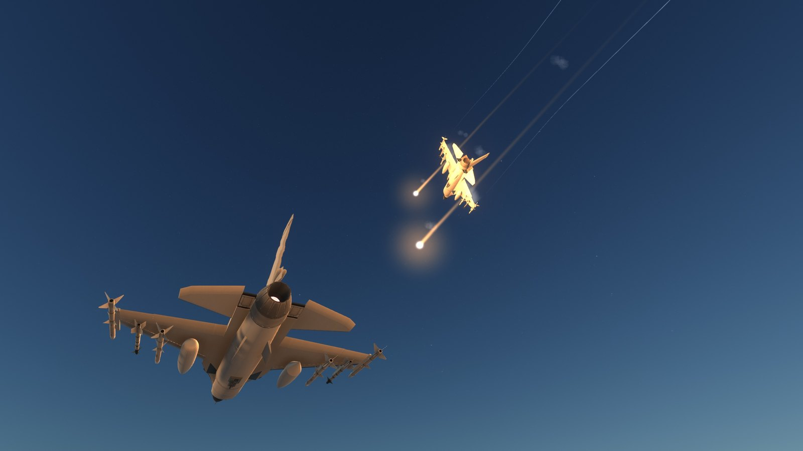

# KSP Aeronautic Flares

A visual add-on for [BDArmory](https://github.com/BrettRyland/BDArmory). It redraws BDArmory's decoy flares with the physically based flame from [aeronautic](https://github.com/Romainlg29/aeronautic)'s countermeasures module. BDArmory keeps all flare behaviour: flight, drag, heat signature, lifetime and how missiles track them. Nothing about gameplay changes.



- **The flame** is an MJU-7 class flare: 253 g of magnesium, Teflon and Viton, burning from every face. Its size and brightness follow the grain as it shrinks, about 250,000 cd as it lights.
- **The airstream** dims the flame as it is swept off the grain, halved at 150 m/s, and less so in thin air.
- **The trail** is what the airstream sweeps off. It glows and cools from white-orange to red along the flare's path, long at release and gone once the flare has slowed.
- **The burn-out** is a fade over the flare's last 0.8 s, so it dims to nothing and does not cut off.
- **The light** is strong enough to light the nearest parts of the aircraft at night.
- **Distance and daylight** are handled: a flare keeps a bright point from far away but glares less the further it is, overlapping flares dim each other so a salvo never blows out, and in daylight the glare and light drop to a fraction.
- BDArmory's own flare smoke is left as it is.

| Day | Dusk |
|---|---|
|  |  |

The grain burns out over BDArmory's own flare lifetime, so the flame ends when the heat signature does.

## Install

Needs BDArmory 1.13.1 ([BrettRyland's fork](https://github.com/BrettRyland/BDArmory/releases)) on KSP 1.12.x. Copy `GameData/AeronauticFlares` into your KSP `GameData`. Without BDArmory it does nothing. If a later BDArmory changes its flare classes, it logs a warning and leaves the stock flares alone.

It needs no shaders or asset bundles: it draws with KSP's own additive particle shader.

## Settings

`GameData/AeronauticFlares/Settings.cfg`, read at start-up (restart KSP after editing). Sizes are in pixels at 1440p and scale with your screen height.

| Setting | Default | What it does |
|---|---|---|
| `enabled` | true | Turns the add-on off (stock flares are drawn) |
| `trail` | true | The streak left behind while the flare is fast |
| `brightness` | 1 | Multiplies the flame, its halo and the flare's light |
| `flameScale` | 1 | Multiplies the flame's physical radius |
| `glarePixels` / `corePixels` | 420 / 44 | Halo and flame radius at full brightness, up close |
| `gain` | 4 | Colour multiplier, so the flame's heart saturates to white |
| `trailPixels` | 5 | Narrowest the trail is drawn |
| `lightIntensity` / `lightRange` | 6 / 80 | The flare's light on the aircraft and ground (range in m) |
| `fullSizeDistance` | 25 | Out to here (m) a flare keeps its full size |
| `farShare` | 0.5 | The least a far flare's glare shrinks to |
| `overlapDim` | 0.5 | How much overlapping halos dim each other |
| `fadeSeconds` | 0.8 | The burn-out fade (0 cuts off) |
| `dayGlare` / `dayCore` / `dayLight` | 0.45 / 0.8 / 0.1 | What the halo, flame and light shrink to in full daylight |

## Build

```
dotnet build -c Release [-p:KSPDir=<KSP install>]
dotnet run -c Release --project tools/check
python tools/package.py
```

The second command checks the KSP-free flare model against upstream's own test assertions. A `-c Dev` build also compiles `Source/Dev/FlareProbe.cs`, a test aid that moves the clock to night and logs flare distances; it is never in a release. How the add-on hooks into BDArmory and draws is in [docs/how-it-works.md](docs/how-it-works.md).

## Credits and license

The flare model is ported from aeronautic by Romain Le Gall (MIT), see [THIRD-PARTY-NOTICES.md](THIRD-PARTY-NOTICES.md). This mod is [CC BY-NC-SA 4.0](license.md).
