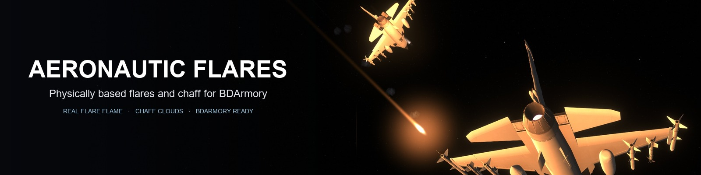
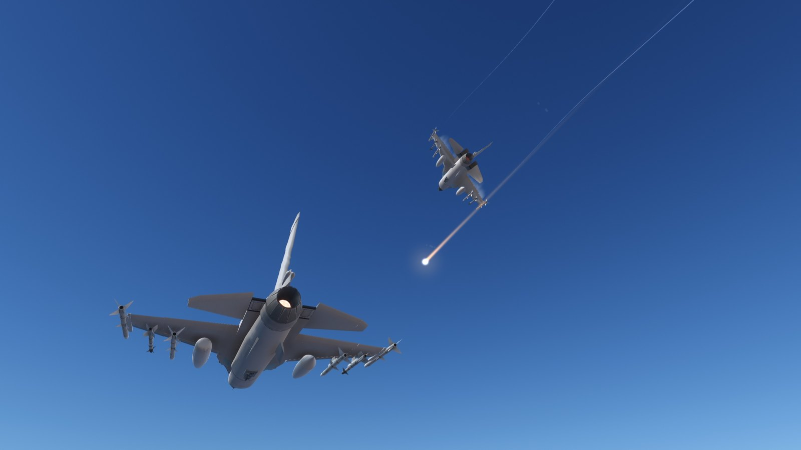
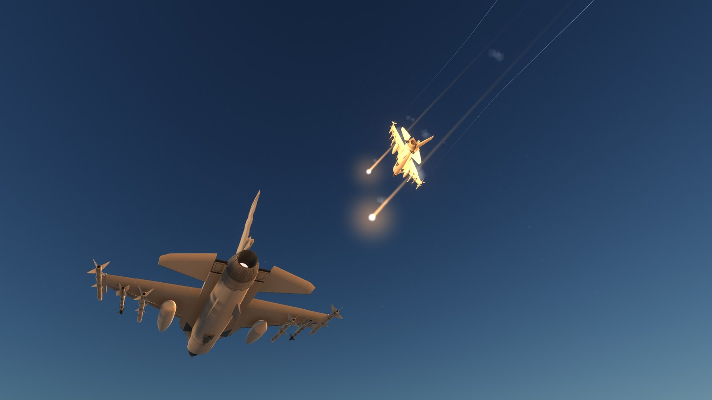

 

**[Download](https://github.com/PogKai/ksp-aeronautic-flares/releases/latest)**
&nbsp;·&nbsp; [Requires BDArmory](https://github.com/BrettRyland/BDArmory/releases/tag/v1.13.1.0)
&nbsp;·&nbsp; [How it works](docs/how-it-works.md)
&nbsp;·&nbsp; [Changelog](CHANGELOG.md)

 

## Overview

A visual add-on for [BDArmory](https://github.com/BrettRyland/BDArmory). It redraws BDArmory's decoy flares and chaff with physically based models ported from [aeronautic](https://github.com/Romainlg29/aeronautic)'s countermeasures module. Install it and fire: there is no per-craft setup, and BDArmory keeps all countermeasure behavior (flight, drag, heat signature, lifetime and missile tracking). Only how they look changes.

| | |
|---|---|
| **Flares** | A white-hot core that streams back along the airstream, a halo, a light and a trail that cools from white-orange to red. The flame follows an MJU-7 class grain as it burns down, and fades over its last 0.8 s instead of cutting off |
| **Chaff** | A faint, wispy cloud that blooms open along the path the aircraft flew, then hangs where it formed, sinking and spreading in the turbulence. Fibres glint in the sun by day and in a flare's light at night |
| **Missile smoke** | Every fired missile leaves a thick white smoke trail: cloud-textured puffs that spread and thin as they age and hang in the air where they formed. Each puff is lit by the sky, the sun's colour and height, terrain in the sun's way and any flare burning nearby, so it is warm at sunset, grey in shade and glows near a salvo. The trail starts at the nozzle once the motor ignites. The missile's own plume smoke is hidden while this is on, so it is not doubled. Switch it on or off in the in-flight window |
| **Light and distance** | A flare lights the nearest parts of the aircraft at night, stays a bright point from far away, and overlapping flares dim each other so a salvo never blows out. In daylight the glare and light drop to a fraction |

| Day | Dusk |
|---|---|
|  |  |

 

## Installation

1. Download `AeronauticFlares_1.1.0.zip` from the [latest release](https://github.com/PogKai/ksp-aeronautic-flares/releases/latest).
2. Copy the archive's `GameData/AeronauticFlares` folder into your KSP `GameData/` folder.
3. Fire.

**Required: [BDArmory 1.13.1.0](https://github.com/BrettRyland/BDArmory/releases/tag/v1.13.1.0)** (BrettRyland's fork), installed first, on **KSP 1.12.x**. Without BDArmory it does nothing. If a later BDArmory changes its flare or chaff classes, the mod logs a warning and leaves the stock effects alone. It needs no shaders or asset bundles: it draws with KSP's own particle shaders and textures it generates itself.

 

## Usage notes

* **In-flight window:** click the button on the stock toolbar in flight to switch flares or chaff back to BDArmory's own effects, turn the missile smoke trails on or off, and set the flare, chaff and smoke brightness, all at once (no restart). Your choices are saved to `PluginData/user.cfg`
* **Visual only:** where a flare or chaff cloud goes, how long it lives and what a missile sees are BDArmory's. The mod changes none of it, and the missile smoke is drawn only: the missile's flight and guidance are untouched
* **Chaff lasts 20 s:** a cloud thins away over its last 7 s, and one removed early fades over 1.5 s rather than vanishing in a frame
* **Tested** with KSP 1.12.5 and BDArmory 1.13.1.0. A volley of 60 flares and 60 chaff clouds at once held 60 fps in the test scene

<b>Settings.cfg</b>: every tuning value

 

`GameData/AeronauticFlares/Settings.cfg`, read at start-up (restart KSP after editing). Sizes are in pixels at 1440p and scale with your screen height.

| Setting | Default | What it does |
|---|---|---|
| `enabled` | true | Turns the add-on off (stock effects are drawn) |
| `trail` | true | The streak left behind while the flare is fast |
| `brightness` | 1 | Multiplies the flame, its halo and the flare's light |
| `flameScale` | 1 | Multiplies the flame's physical radius |
| `glarePixels` / `corePixels` | 420 / 44 | Halo and flame radius at full brightness, up close |
| `gain` | 4 | Colour multiplier, so the flame's heart saturates to white |
| `flameStreak` | 3 | How far the white-hot core streams back in the airstream (0: round); more by day |
| `trailPixels` | 5 | Narrowest the trail is drawn |
| `zoomReferenceFov` | 0 | The field of view (degrees) the pixel sizes are meant for; zoomed in past it, flames and halos shrink in proportion, down to 8%. 0 leaves them fixed; try your normal field of view, such as 60 |
| `lightIntensity` / `lightRange` | 1.5 / 25 | The flare's light on the aircraft and ground (range in m) |
| `fullSizeDistance` | 25 | Out to here (m) a flare keeps its full size |
| `farShare` | 0.5 | The least a far flare's glare shrinks to |
| `overlapDim` | 0.5 | How much overlapping halos dim each other |
| `fadeSeconds` | 0.8 | The burn-out fade (0 cuts off) |
| `dayGlare` / `dayCore` / `dayLight` | 0.45 / 0.8 / 0.1 | What the halo, flame and light shrink to in full daylight |
| `chaff` | true | Draw the chaff cloud (false: BDArmory's sprite) |
| `chaffBrightness` | 1 | Multiplies the cloud's haze and glints |
| `chaffSeconds` | 20 | How long a cloud hangs in the air |
| `chaffFadeSeconds` | 7 | Over the last this many seconds it thins away to nothing |
| `chaffGlints` | 240 | How many glints a cloud has |
| `chaffGlintWidth` | 0.05 | How near square to the light's mirror direction a fibre glints (radians) |
| `turbulence` | 0.003 | The air's turbulence (m2/s3), which spreads a cloud |
| `missileSmoke` | true | The smoke trail behind fired missiles (also the in-flight window's toggle) |
| `smokeDensity` | 1 | Multiplies the smoke's opacity |
| `smokeWidth` / `smokeGrowth` | 1 / 7 | The trail's width at the motor (m) and how many times that it spreads to |
| `smokeSeconds` | 10 | How long a puff hangs in the air |

 

## Known issues

* **Chaff stutter while accelerating:** a chaff cloud can stutter as it falls away while the aircraft is accelerating. Chaff dropped at steady speed is smooth. The cause is under investigation
* **Tested on one setup:** KSP 1.12.5 with BDArmory 1.13.1.0. Other versions are not tested

 

## Documentation

| | |
|---|---|
| [How it works](docs/how-it-works.md) | How the add-on hooks into BDArmory, the flare and chaff models, and how they are drawn |
| [Changelog](CHANGELOG.md) | Every release |

 

## More from PogKai

| | |
|---|---|
| [WingtipVortex](https://github.com/PogKai/ksp-wingtip-vortex) | Physics-driven wingtip vortices, contrails and raymarched wing vapor for KSP 1.12.x |
| [Aeronautic Afterburner](https://github.com/PogKai/ksp-aeronautic-afterburner) | Raymarched afterburner plumes for KSP aircraft, also ported from aeronautic |

 

## License

[CC BY-NC-SA 4.0](license.md): free to use and share, never to sell. You can use it in your own game, videos and streams, change it and build on it, and share it or bundle it in a free modpack, as long as you credit PogKai, link back to this repository, don't sell it, and share anything built from it under the same license.

 

## Credits and references

The flare and chaff models are ported from [aeronautic](https://github.com/Romainlg29/aeronautic) by Romain Le Gall (`@aeronautic/countermeasures`, commit `db04669`). The upstream code is used under the MIT License; its copyright and license text are in [THIRD-PARTY-NOTICES.md](THIRD-PARTY-NOTICES.md), and each ported file names its upstream source.

The upstream models rest on published work:

* **Flare burn rate and band energy:** Debnath et al., *Central European Journal of Energetic Materials* 22(2), 2025 (MTV1 composition)
* **Chaff:** the one-mil chaff measurements of Stine (1980) and US patent 4,653,403
* **Colour and brightness:** the CIE 1924 photopic luminosity function

This mod contains no BDArmory code, textures or models. It finds BDArmory's flares at run time and changes how they are drawn.

 

## Building from source

`dotnet build -c Release -p:KSPDir="<your KSP folder>"` builds `bin/Release/AeronauticFlares.dll`. [How it works](docs/how-it-works.md) describes the code.
